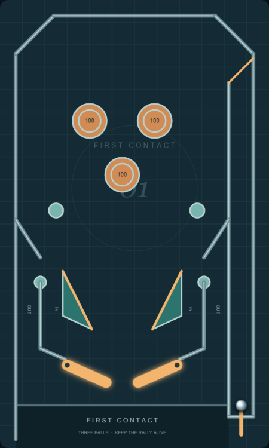
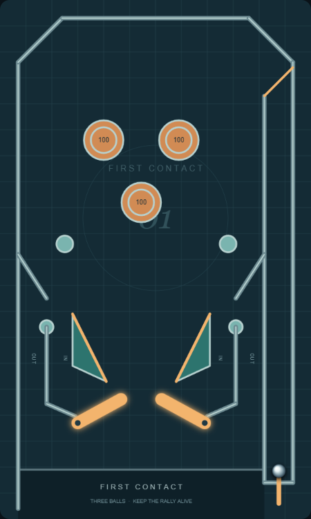

# Ball scale and sling correction

Supersedes the proportions in fresh-layout-review.md. User feedback identified the whole playfield as too narrow for the ball, with sling tips too far over the paddles. The chassis remains 6 by 10 arcade units; playable width excludes the shooter channel and is 4.75 units. Ball radius changes .18 to .13: playable width grows from 13.2 to 18.3 ball diameters, a 38% increase in relative room. This is an arcade proportion choice, not a measured real-machine calibration.

Sling inward tips move from x=2.4/3.05 to x=2.05/3.4, .35 outward on each side; the central opening between their innermost extents grows from .65 to 1.35. Outer vertices move outward too, and triangular undersides slope toward the inner tips instead of forming horizontal shelves over the paddle tips. The sling bottom is y=7.35 and both moving flipper sweeps are clear. Pivots, flipper length, actuator strengths, chassis and upper mechanisms are unchanged.

Smaller-ball checks exposed a slow heel pocket in the original guide/pivot join. Final guides run vertically to y=7.78 then toward x=1.45/4 at y=8.02, near-tangent to the upper resting heel. Several rejected joins were tested before this fix; none were accepted based solely on generated warnings. Slow feeds, held catches after release and unattended three-ball games now pass for both actuators.

## Rendered comparison

Both views were inspected against the user's Star Trek and Pinball Star reference pattern. Sling tips no longer extend above the paddle-tip region; lane and ball proportions offer more space, with a wider center fan. The sparse arcade layout, straight rails and decorative apron remain deliberate departures; user recognition and good feel are still unproven.

| Shot / route | Origin | Reachable | Return | Problem / finding |
| --- | --- | --- | --- | --- |
| Wall descents | 36 generated upstream arrivals | Ordered feed then paddle checked | All 36 have sampled upward redirection | Timing sampling is not a human control guarantee |
| Inlanes / heels | Both sides, slow/fast, both actuators, released/held then released | Full-ball feeds and full flipper travel pass | No retained heel pocket; natural drain after release | Low-speed generated states still require control interpretation |
| Bumper aims | Both flippers, three pops, two speeds | All 12 families reachable | Successful-hit followups run | Independent aiming/second-action play unproven |
| Loss routes / lifecycle | Upstream outward misses and charge sweeps | Both outlanes, center drain, shooter entry pass | Three-ball games finish naturally | Fairness remains human feedback |

Evidence: type checking and all 50 tests pass; default evaluation executes 2,163 simulations from 225 clear spatial starts, with zero required failures and 14 diagnostics. Eight input-responsive slow states, four moving censored runs and two successful bumper shots without later paddle contact remain; no sampled wall-control gap remains. Replay details are in results/layout-evaluation.json. The ordered-route test now follows the table-relative left shot preset, avoiding another obsolete fixed arrival/timing fixture while retaining ordered-event assertions. Browser resting/raised views, launch, paddles, Z/X/C nudges and reset verified without errors. No claim of fun or realistic physical calibration.

