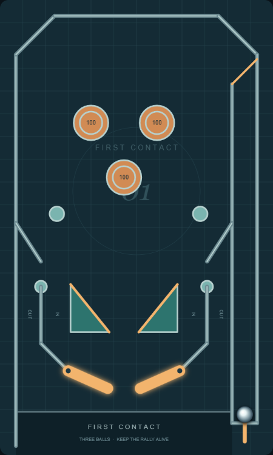
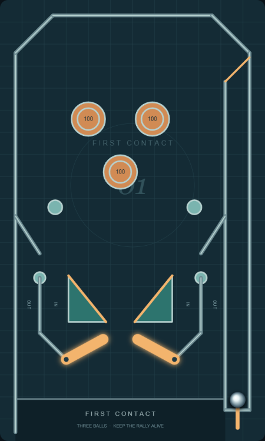

# Fresh reference-led demo layout

The user's overhead Star Trek photograph and perspective Pinball Star screenshot supplied the lower-field pattern: paired downward-resting flippers, substantial triangular slings, adjacent protected inlanes and outer loss lanes, and a cabinet apron below the control area. We inspected both source images; perspective and artwork do not provide calibrated dimensions. This is an open single-level arcade adaptation, with no borrowed ramps, upper flippers or elaborate modes.

The previous demo is preserved in layout-before-fresh-assembly.json. The new assembly was proportioned as a whole before route tuning: center x=2.725 excluding the shooter, pivots x=1.5/3.95 at y=8.15, flipper length .95, paired sling footprints .85 wide by 1.05 tall, straight lane boundaries followed by .6-by-.6 diagonal heel feeds, and apron top y=9.05. The pop cluster was recentered above the open aiming fan. Launch/gate, physics calibration and actuation baseline are retained.

## Visual comparison (separate from simulation)

| Relationship | Reference observation | Actual rendered finding / departure |
| --- | --- | --- |
| Flippers | Outer pivots, inward/downward rest, inward/upward stroke | Both poses inspected; rest tip surface gap about .475 for a .36 ball diameter; no decorative flipper extensions |
| Slings | Broad triangles frame the aiming fan above flippers | Wider .85-by-1.05 footprints replace skinny wedges; inward faces highlighted, passive lane faces distinct; full raised stroke clear |
| Inlanes | Separate corridors feed the outer heels through short diagonal guides | Connected wall runs to both pivots; labeled IN; deliberately straight arcade lane boundaries rather than curved machine rails |
| Outlanes | Outer branches bypass paddles | Labeled OUT beside lane-divider posts, both mechanically open; no powered rescue |
| Lower boundary | Apron closes the visible cabinet below paddles | Opaque apron below y=9.05; loss balls pass beneath it; shooter remains visible; no new collision wall |
| Upper field | References have complex shot systems | Deliberate sparse pop nest and open fan, no elevation or cosmetic ramps |

The assembly is more coherent in the saved renders, but recognition and feel still need user feedback. No simulator metric certifies visual similarity. Upper wall collectors remain simple straight arcade segments with visible branch entrances, not a literal tracing of either machine.

## Route evidence

| Shot / route | Origin | Reachable | Return | Problem / finding |
| --- | --- | --- | --- | --- |
| Launch / gate | Seven charge levels, both actuator models | Enters main play; downward gate deflects left | Shooter-return and three-ball lifecycle regressions pass | No skill-shot reward implemented |
| Wall feeds / inlanes | 36 upstream arrivals including slow descents and lateral offsets | All core straight arrivals pass ordered feed then paddle contract | All core arrivals have sampled contact-then-upward return | Four slow angled arrivals have no redirection in bounded sampled timings; retained diagnostics |
| Bumper fan | Both flippers, three pops, two speeds | All twelve families have sampled hits | Successful-hit followups evaluated downstream | Independent aiming and second-action control unproven |
| Slings | Inward and passive-side contacts | Only inward face scores/kicks | Local rebound and lane-exit regressions pass | Human rebound difficulty untested |
| Lane / heel slow states | Both actuators, released and held/released feeds | No persistent trap in required cases | Held catches release; heel redirection regression passes | Eight generated slow states respond to recovery inputs; control usefulness still uncertain |
| Outer / center losses | Upstream lateral misses and central downward arrivals | Both outlanes and center loss remain open | Unattended three-ball games naturally finish | No fairness claim |

Routine evaluation: 2,115 simulations, 209 clear spatial starts, 36 wall arrivals and 12 bumper approach families. Zero required failures; 19 diagnostics (seven moving censored runs, eight input-responsive low-speed states, four slow angled arrivals without sampled upward return). Full replay inputs and trajectories: results/layout-evaluation.json; regenerate with node scripts/evaluate-layout.js. Contracts were not relaxed for the redesign. Negative tests still discover missing collectors and inaccessible passive pockets automatically.

Type checking and all 50 tests pass. The ordered-route laboratory fixture uses the observed fresh-layout stroke delay 68 rather than the obsolete 64; its event ordering assertions are unchanged. Browser startup, resting/raised flippers, launch, three nudge keys and reset verified in Edge without page errors. These checks establish mechanics only, not good feel.

Skill update: the entrypoint now requires a Visual assembly review before numerical tuning and again after geometry changes, including saved rest/raised views, reference proportions, connected boundaries and named departures. The Python skill validator could not run because PyYAML is missing; required frontmatter, existing local references and the new section link were inspected manually.
